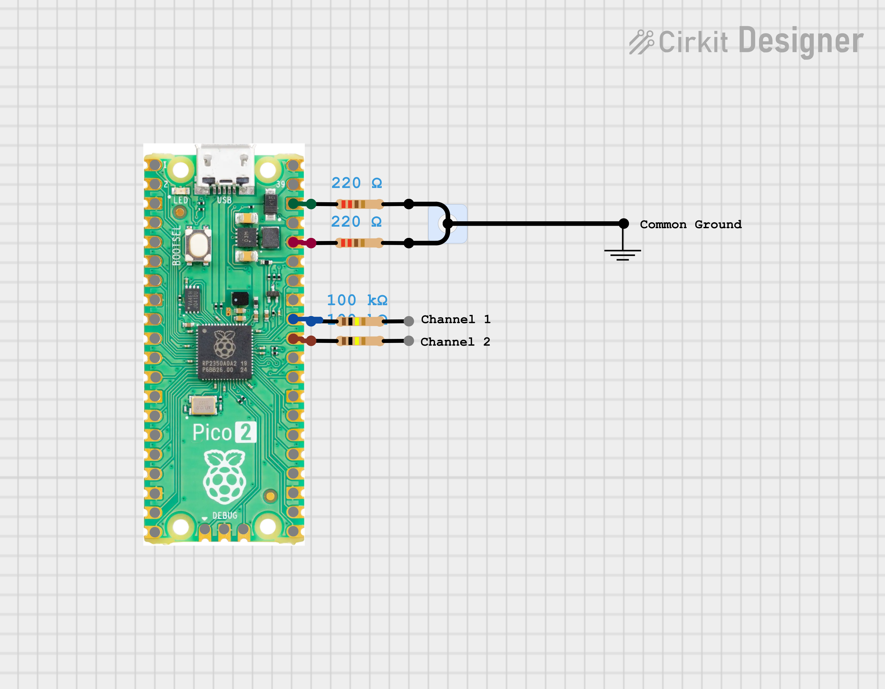

# 🚀 Raspberry Pi Pico 2 Based Oscilloscope (Scoppy)

A low-cost, high-performance 2-channel oscilloscope and logic analyzer built with the **Raspberry Pi Pico 2 (RP2350)** and the **Scoppy** firmware.

## 🌟 Overview
This project turns a $5 Raspberry Pi Pico 2 into a functional oscilloscope that connects to your Android phone or tablet. It leverages the Scoppy firmware (v18) to provide a rich touch-based interface for visualizing analog and digital signals.

### Key Features
- **Channels**: 2 Analog Inputs (via RP2350 ADC).
- **Sample Rate**: Up to 500kS/s (depending on Scoppy version and device).
- **Interface**: Android App via USB OTG.
- **Hardware**: Minimal components (Pico 2 + common resistors).

---

## 🛠️ Hardware Requirements
- **Microcontroller**: [Raspberry Pi Pico 2](https://www.raspberrypi.com/products/raspberry-pi-pico-2/) (RP2350).
- **Resistors**:
  - 2x **100kΩ** (Input protection for Ch1 & Ch2).
  - 2x **220Ω** (Output/signal generation indicators).
- **Connection**: USB OTG Cable (to connect Pico 2 to Android).
- **Software**: [Scoppy App](https://play.google.com/store/apps/details?id=xyz.fhdm.scoppy) (from Google Play Store).

---

## 🔌 Connection Guide
Refer to the `circuit_image.png` for the wiring layout:

1. **Channel 1**: Connect to **GP26 (Pin 31)** through a **100kΩ** resistor.
2. **Channel 2**: Connect to **GP27 (Pin 32)** through a **100kΩ** resistor.
3. **Ground**: Connect the **Common Ground** to **GND (Pin 38)**.
4. **Signal Outputs**: Connect **GP??/VSYS/VBUS** through **220Ω** resistors to Ground as per the schematic (optional/indicator).

> [!WARNING]  
> **Input Voltage Limit:** The RP2350 ADC pins only support **0V to 3.3V**. Applying voltages outside this range (especially negative or >3.3V) will DAMAGE the Pico 2. For higher voltages, use an Analog Front-End (AFE) circuit.

---

## 💾 Installation

### 1. Flash Firmware
1. Unplug your Raspberry Pi Pico 2 from the computer.
2. Hold the **BOOTSEL** button and plug it into your USB port.
3. A new drive named `RPI-RP2` will appear.
4. Drag and drop the file `scoppy-pico-v18.uf2` from this repository onto that drive.
5. The Pico 2 will reboot automatically and is now ready.

### 2. Connect to Android
1. Install the **Scoppy** app from the Play Store.
2. Connect your Pico 2 to your Android phone using a **USB OTG cable/adapter**.
3. Grant the app permission to access the USB device when prompted.

---

## ⚖️ License & Attribution
- This project utilizes the **Scoppy** firmware developed by **fhdm-dev**.
- For official documentation, firmware updates, and advanced AFE designs, visit the [Scoppy Website](https://fhdm.xyz/) and [GitHub Repository](https://github.com/fhdm-dev/scoppy).

---

## 🤝 Contributing
Feel free to fork this repository, submit pull requests, or open issues for hardware improvements (like adding a proper Analog Front-End).

---
*Created with ❤️ for the electronics hobbyist community.*
